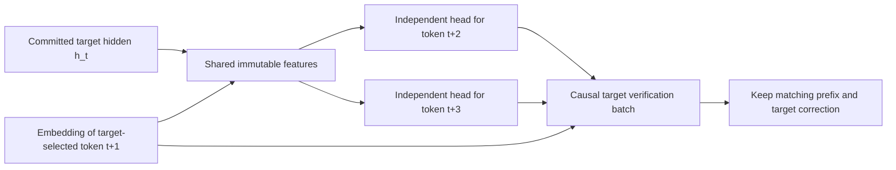

# Native parallel proposal heads

The first live adapter is the `qwen36` CPU engine, qualified initially on the
pinned Qwen3.5-0.8B native container. It captures the target's hidden frontier,
runs independent learned heads together, and verifies their guesses through
Colibri's existing causal batch. Accepted recurrent/KV states are retained;
rejected rows are rolled back without replaying accepted tokens.

This is an experimental adapter, not a claim of faster inference or coverage of
every model. Other native families and device execution are still pending.
An isolated measurement of the current rank16 bank against the same optimized
engine found a **0.9779 median paired decode ratio (2.2% slower)**. Its held-out
offset2/3 accuracy is 12.9%/8.0%; both match on 3.2% of shared states. These heads
preserve output through target verification, but do not yet deliver useful
acceleration. [Isolated measurements](../experimental/strata/results/unbiased-cpu-optimizations.json)

The first hidden-only learned head preserved held-out token IDs/log probabilities
but measured a median paired decode ratio of **0.975** on three held-out prompts
with five paired repeats each. It was slower.

The improved two-head bank was then compared with regular Colibri with prompt
lookup enabled in both arms: median arm rates **39.829 vs 39.471 tokens/s**;
15 paired runs, eight candidate wins and seven losses. The median paired ratio
was 1.0146, but workloads/runs disagreed, so this establishes **no clear repeatable
speedup**. All three separate correctness requests matched token IDs and numeric
DATA frames. [Measured comparison](../experimental/strata/results/native-cpu-comparison.json)

## Parallel work and causal verification



The embedding input is already known before the target's next forward. No head
receives another head's guess. Native heads use one OpenMP team across the bank,
AVX2 where available and a scalar fallback. A prediction bank is called once
even when the gate chooses a shorter prefix; its entire cost is charged once.
The gate measures target batch cost and conditional acceptance by offset, and
can select a plain target step when speculation loses time.

## Independent cached-logit residual heads

CSNH v2 banks can retain the target's existing raw output scores and add a
horizon-specific low-rank correction. For each head independently:

```text
features = [committed normalized hidden, embedding of target-selected token1]
latent_j = DOWN_j @ features
scores_j = raw_target_logits + UP_j @ latent_j + bias_j
```

Both heads share the same immutable raw target logits and features. Neither
reads the other's prediction. This formulation reuses the pretrained output
weights during training/factorization without a second full vocabulary
projection at runtime. The native adapter owns a raw-logit copy before sampler
mutation and retains the matching hidden/logit row after verifier acceptance;
rejection, cancellation and conversation reset preserve the same frontier rule.

The local rank24 INT8-source prototype improves offset2 accuracy to **69/279
(24.7%)**, while offset3 remains **20/276 (7.2%)**. Both match on 10/279 states,
giving a mean **0.283 accepted extra tokens** per attempt in the development
split. Fitting used training-only rows; this separate split informed subsequent
prototype selection, so runtime benchmarks use additional fresh prompts.
[Quality and numeric evidence](../experimental/strata/results/residual-head-quality.json)
These accuracy figures alone do not establish acceleration.

The fresh three-prompt,15-pair native trial gives a **0.9706 median paired
decode ratio (2.9% slower)** with these heads enabled. All separate greedy
numeric checks match. In one timed run per prompt, the parallel gate judged
14/6/11 first-extra-token guesses and accepted 1/0/2: **3/31** across the three
requests. No third-token head was judged in those runs. This is a small,
gate-selected sample, not an unbiased full-trace accuracy estimate. Its lower
acceptance and the bank/verification cost explain why improved development
accuracy has not yielded runtime acceleration. Heads remain opt-in.
[Fresh paired measurements and actual bank counters](../experimental/strata/results/residual-fresh-cpu-comparison.json)
[Real-model frontier correctness](../experimental/strata/results/residual-frontier-correctness.json)

Format/API selection is explicit: `(version,kind)=(1,0)` uses ordinary scores;
`(2,1)` requires cached-logit residual scores. Ordinary prediction APIs refuse
residual banks and vice versa. The existing `sn_info` C/ctypes layout remains
unchanged. Both formats validate signed INT4/8/16 source storage, identity,
finite values and bounded allocation; proposal computation remains F32 CPU
with double dot accumulation. Export tagged residual JSON packs using
`c/tools/export_native_heads.py --bank-kind logit-residual`; ordinary packs
cannot be silently reinterpreted as residual banks.

The CPU output projection batches all verified rows where the arithmetic is
byte-identical to the old rowwise implementation. Packed INT4, AMX and device
routes retain their existing guarded projection paths. MoE prefill staging now
budgets chunks by distinct experts, with bounded scratch and balanced cache
holds; repeated expert IDs no longer consume the budget repeatedly.

## Qualification and identity

- Native adapter: CPU, one KV slot, dense INT8 with integer-dot activations,
  ordinary text, greedy proposals. CUDA tier, active Vulkan, device recurrence,
  cache-dependent routing, qpack and Clef are explicitly refused for now.
- Sampling requests keep the existing target/lookup behavior with learned heads
  disabled. Distribution-correct sampled parallel speculation remains pending.
- A CSNH bank binds the native tensor/config/tokenizer bytes, numerical mode and
  feature tap. A same-shaped pack from another target is refused.
- Signed INT4/INT8/INT16 are **source weight storage** formats for the bank. The
  loader validates/dequantizes once into immutable F32 CPU weights. This does
  not qualify integer compute or INT16 target weights on every accelerator.
- Source models must stay immutable while fingerprinting and running. The hash
  provides identity, not an authenticity signature.

The current augmented feature descriptor is:

```text
qwen36:DBITS=8;IDOT=1;kernel=cpu;tap=final-rmsnorm+next-embedding/v1
```

Training scales each feature using training-only coordinate RMS, then folds the
scale into the exported down-projection. Runtime inputs and identity stay the
same. Whole-request held-out traces must remain separate from training.

## Reproduce with an existing native container

Install the optional CPU trainer from `experimental/strata/requirements-training.txt`.
Use a pinned native model container and separate JSON arrays of training and
held-out prompts. The commands below assume Linux and repository-root paths.

```sh
make -C c qwen36 strata-native-check
python c/tools/capture_native_heads.py --engine c/qwen36 --model MODEL_DIR \
  --revision PINNED_SOURCE_COMMIT --prompts training-prompts.json \
  --raw training-raw.jsonl --output training.jsonl
python experimental/strata/heads.py --trace training.jsonl --out heads.json \
  --offsets 2,3 --rank 16 --steps 1200 --batch-size 16 --learning-rate .005
python c/tools/export_native_heads.py --model-dir MODEL_DIR \
  --runtime-precision 'qwen36:DBITS=8;IDOT=1;kernel=cpu;tap=final-rmsnorm+next-embedding/v1' \
  --pack heads.json --output heads.snh --bits 8
c/coli run --model MODEL_DIR --gpu none --parallel-heads heads.snh \
  --head-input next-embedding --temp 0 'Explain CPU caches.'
```

Capture and export preserve existing files. A new output path is required for
each trial. The fingerprint check reads the actual native assets and adds cold
startup work; measure cold launch separately from warmed decode.

The native benchmark accepts an unchanged baseline executable and the candidate:

```sh
python c/tools/native_decode_bench.py --baseline BASELINE_ENGINE \
  --feature c/qwen36 --model MODEL_DIR --prompts heldout-prompts.json \
  --heads heads.snh --head-input next-embedding --lookup --tokens 64 --repeats 5 \
  --output paired-results.json
```

It checks actual token IDs and numeric DATA frames separately from timing,
interleaves warmed paired requests and retains bank/gate diagnostics. Run it
after training, compilation and correctness harnesses finish. The optional
`--wsl DISTRO` launcher uses argument arrays and translates Windows paths.
`--lookup` retains Colibri's existing prompt-lookup speculation in both arms,
the comparison against regular Colibri behavior. Omitting it is a separate
ablation isolating the new heads and must be labeled lookup-disabled.

`c/tests/native_head_frontier_harness.py` tests active-bank rejection, acceptance,
budget clipping, EOS, cancellation, prefix reuse and precision refusals against
a real native checkpoint. Its controlled synthetic banks are correctness
fixtures; their acceptance cannot substantiate a speed or learned-quality claim.

`make -C c strata-native-sanitize` checks the loader and kernel tests under
ASan/UBSan. Hardware qualification and all-family rollout remain separate gates.
