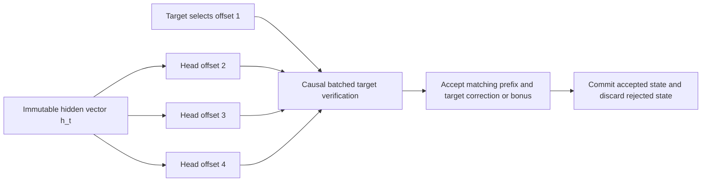

# Architecture and source audit

This fork adds reusable experimental interfaces across all **ten text engine
families** in the upstream registry. Shapes are parameters, not Qwen constants.
That does not mean a head trained for one model can be used in another model.
Image and decision outputs have no future-token decoding contract.

## Independent heads, then a causal target check

Each learned head computes `up @ (down @ h_t) + bias` independently. The portable
implementation uses F32, checked element counts, finite-value checks and lowest-id
greedy ties. All heads can run simultaneously under OpenMP. This does not make
the target model noncausal: the verify rows use the usual causal mask, and only a
matching prefix is accepted. Tokens are pieces of words, not necessarily whole words.

`h_t` predicts token `t+1` through the target output head. Therefore the learned
draft offsets normally start at **2**, not 1. To form the verifier's immediate-next
proposal, prepend the target's already selected token at offset1. Engine adapters
must reject sparse/out-of-order head offsets rather than silently shift them.

The C verifier is a **greedy reference**. It snapshots, calls the target's causal
batch, restores and replays the committed tokens. This makes state semantics
testable but can erase a speed gain. It has no stochastic rejection-sampling
implementation. Production adapters must retain accepted states efficiently and
prove equivalence before exposing acceleration. A learned guess is never accepted
without the target model's decision.

## All-family integration map

| Registry family / model examples | Existing upstream verification | Additional state/adapter work | New live parallel heads |
|---|---|---|---|
| `glm`: GLM-5.2/5.3 | MTP/lookup/grammar/corpus; batch verify | Readout hidden tap, head identity, KV/prefix rewind | Pending |
| `qwen38`: Qwen3.8-Flash-Next | MTP and lookup; six-row verify | DeltaNet, convolution, PLE history, device mirrors | Pending |
| `qwen36`: Qwen3.6, Qwen3-Coder, dense Qwen3.8-27B | Lookup; six-row verify under supported backends | Hidden tap plus hybrid recurrence/conv snapshots; preserve backend guards | Pending |
| `deepseek_v4`: V4 Flash | Lookup/Markov/DSpark with opt-in batch verify | Compressed attention/window state, snapshots and replay cost | Pending |
| `deepseek_v41`: V4.1 Flash | DSpark and batched verify | Window/compression undo and DSpark source selection | Pending |
| `glm53`: GLM-5.3-Flash | Prefill/all-row logits; no live verifier found | KDA/conv per-row undo, hidden tap and new verifier | Pending |
| `inkling`: Inkling | Batched prefill/teacher-forced readout | Sliding rings, four conv banks, all-row target logits | Pending |
| `kimi`: Kimi K3 | Batched prefill; last logits | KDA/conv/MLA state, all-row logits and new verifier | Pending |
| `mimo`: MiMo-V2.6 Flash/Pro | Batched prefill with all-row logits | Sliding KV rings and new verifier | Pending |
| `olmoe`: OLMoE | Batched prefill; last logits | All-row readout, KV/prefix rewind; smallest missing verifier | Pending |
| `qwen_image` | Image denoising | Future-token heads inapplicable | N/A |
| `laya`, `gliner_decide` | Decision scoring | Future-token heads inapplicable | N/A |

Clef chat follows qwen36; Clef decision scoring is inapplicable. The machine-readable
[coverage manifest](../experimental/strata/families.json) is checked against the
actual upstream `c/family_registry.py` so no family can disappear unnoticed.

## What Strata actually contributes

The source inspected is pinned to
[Strata 61b3fb5](https://github.com/Niko1221/Strata/tree/61b3fb5dd3f1e8ec09cf7e4e05208bc6d3c46406),
and the Colibri base is
[bf24429](https://github.com/JustVugg/colibri/tree/bf2442915d6e3dd4cdfd2eb9c2a3d2aa44a25850).

- This is software scheduling and memory hierarchy management; no motherboard is
  redesigned. Qwen geometry is fixed in Strata's `include/strata/core/layout.hpp`.
- Native MTP drafting is **dependent/sequential** in `src/core/mtp.cpp` around
  lines 1362–1373. The expensive target checks multiple proposed tokens in a batch.
- Prefill expert staging overlaps transfer and math with explicit stream events
  (`src/prefill/prefill.cpp`, around lines 3592–3637 and 3772–3774). Predicted
  routing can miss. Decode also computes nonresident experts on CPU concurrently
  with GPU-resident experts; PCIe costs are overlapped where possible, not erased.
- Hot experts adapt through frequency, victim selection and decay
  (`src/program/generate.cpp`, around lines 12563–12631), rather than being frozen
  permanently. A selection policy is distinct from actual page/device residency.
- Standard auto prefill is up to 8192; 6144 is a Windows HIP cap in the inspected
  revision. Chunk size must respect workspace and VRAM budgets.
- CLI default KV is FP16; INT8 and other compressed modes are options. Its current
  documentation includes 262K context and experimental longer contexts. Neither
  context capacity nor quantization guarantees constant latency or unchanged quality.
- Published 12GB RTX 5070 Q2_0 decode figures fall from 93.0 tokens/s at 4K context
  to 73.7 at 128K and 60.3 at 262K (`docs/DETAILS.md`, line 54). These are Strata's
  reported results, not this fork's measurements or a hardware-independent promise.

Colibri already has expert popularity tracking, prefetch, placement, native MTP,
and cache compression in selected engines. Its GLM `KV8` uses FP8 E4M3, which is
different from this fork's symmetric INT8 block reference. The roadmap integrates
with existing mechanisms instead of introducing conflicting default policies.

## Memory contracts

`c/strata_memory.h` offers three independent primitives:

1. INT8 vector blocks with per-block maxabs metadata and checked finite input.
   Encoded state is immutable during decode. It is a lossy codec, not an attention
   kernel or a universal KV layout. Ring eviction, position indices and speculative
   rollback remain the engine's responsibility.
2. Decaying hot-expert scores and a deterministic selection within a caller's byte
   budget. The policy preserves router choices and weight precision. The backend
   still needs VRAM reservation, admission, event fencing and allocation failure recovery.
3. Two-slot asynchronous prefetch state. A slot cannot be reused while transfer or
   consumption is in flight. The requested expert identity is checked at acquisition;
   a lookahead miss must follow the ordinary demand path. Real CUDA/HIP callbacks
   and event/transfer profiling are pending.

No new environment flag turns these primitives on in `coli chat` yet. Tests cover
the portable core and a toy causal model; they do not establish real-model parity,
acceptance rate, quality or faster decoding.
